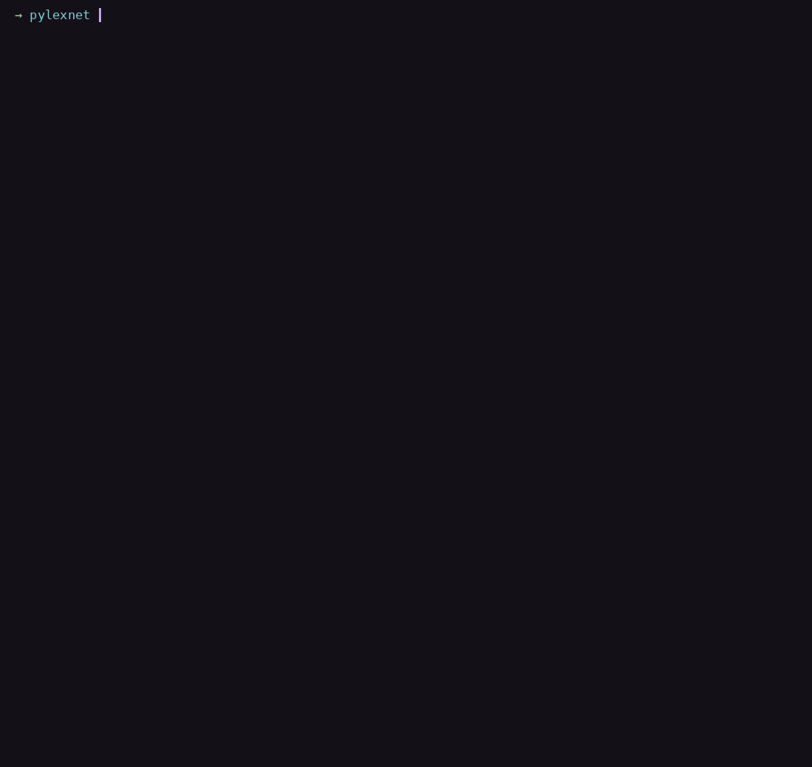
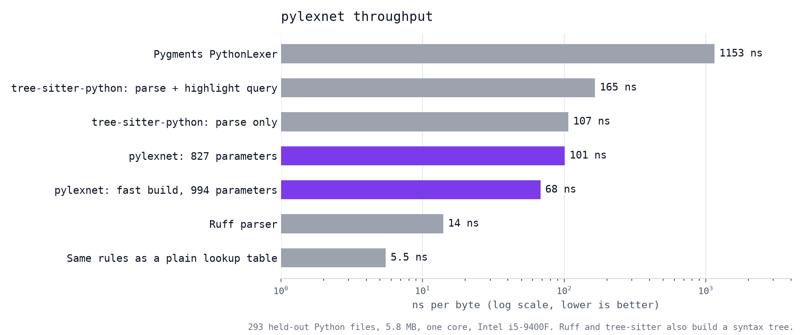

# pylexnet

A neural network for Python syntax highlighting, with hand-designed weights and no training data. It has 827 parameters, counting every non-zero value.

A Python counterpart to [lexnet](https://huggingface.co/alpindale/lexnet). Designed with Claude Fable 5.1 and Claude Opus 5.5.



## Usage

```bash
make
./pylexnet file.py
```

`--classes` prints one class id per byte. `--interp` runs the generic evaluation of the same weights.

## Model details

| | |
|---|---|
| Type | Bidirectional recurrent network, per-byte sequence tagger |
| Task | Token classification over Python source |
| Input | Bytes |
| Output | One of 9 classes per byte |
| Parameters | 827 non-zero |
| Activations | `Clip(x, 0, hi)` |
| Vocabulary | 269 keywords, builtins and special method names |
| Training data | None |
| Training compute | None |

## Accuracy

Per-byte agreement with Pygments 2.17.2 on held-out code.

| Set | Size | Agreement | Exact files |
|---|---|---|---|
| Python 3.12 standard library | 5.8 MB | 99.996% | 264 / 293 |
| Third-party packages | 30 MB | 99.995% | 3,059 / 3,177 |

## Speed



293 files from the standard library, single core, Intel i5-9400F.

| Executor | ns/byte |
|---|---|
| Ruff parser | 14 |
| pylexnet, `builds/fast-994` | 68 |
| **pylexnet** | **101** |
| tree-sitter-python, parse only | 107 |
| tree-sitter-python, parse and highlight query | 165 |
| Pygments `PythonLexer` | 1,153 |

Ruff and tree-sitter build a syntax tree, which pylexnet does not.

## Other builds

| Build | Parameters | ns/byte | Third-party agreement |
|---|---|---|---|
| `builds/fast-994` | 994 | 68 | 99.9945% |
| `builds/accurate-7370` | 7,370 | 91 | 99.9992% |

`fast-994` shares one threshold weight across rows and keeps 220 of the words; counted per row it has 1,502 parameters. `accurate-7370` is a compiled automaton, not a hand-designed network.

## Limitations

Soft keywords (`match`, `case`), two-level nested f-strings and a few other cases aren't handled. The vocabulary matcher is approximate, so a few words such as `an` are flagged as keywords.
